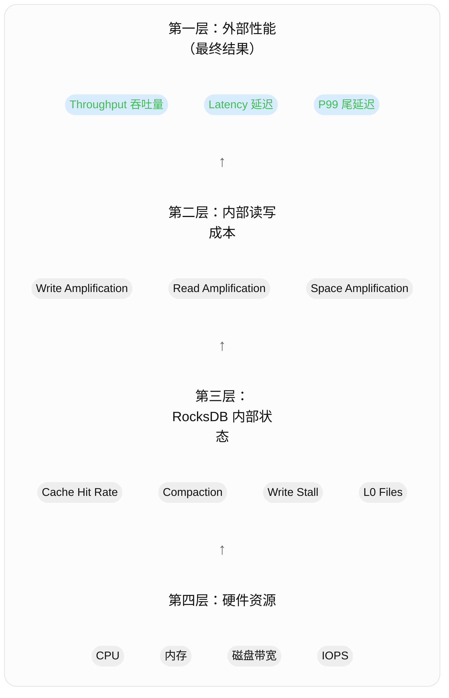
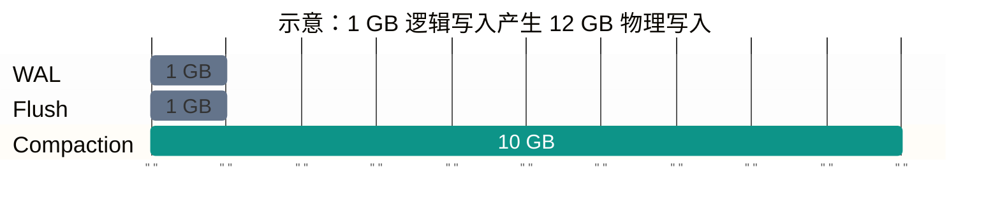

# RocksDB 相关的性能指标

[原回答](https://chatgpt.com/s/t_6ae9e5c29f748191bdfd120a37a179f4)

理解 RocksDB 的性能指标，最重要的是建立一个思路：

性能指标不仅是为了衡量 RocksDB 有多快，更重要的是解释它为什么快、为什么慢，以及性能瓶颈在哪里。

## 一、RocksDB 性能指标的整体框架



这四层不是严格的单向因果链，而是一套从最终性能追踪内部原因的分析框架。

例如：
- 用户发现 P99 写入延迟变高。
- 查看 RocksDB 内部指标，发现 Write Stall 增加。
- 进一步发现 L0 SST 文件积压，Compaction 跟不上。
- 最后检查磁盘，发现后台 Compaction 消耗了大量写入带宽。

这样，就从一个外部性能问题定位到了内部瓶颈。

## 二、第一类：吞吐量、延迟与 P99
这是评价一个数据库性能时首先要看的指标。

### 1. Throughput（吞吐量）
表示数据库单位时间内完成多少操作。

最常见的单位是：
- ops/s：每秒完成的操作数。
- MB/s：每秒处理的数据量。

公式：
$$
\text{Throughput}=\frac{\text{完成的操作数量}}{\text{总时间}}
$$

假设 RocksDB 在 10 秒内完成 100 万次 Put：
$$
\text{Throughput}=\frac{1,000,000}{10}=100,000\ \text{ops/s}
$$

说明每秒可以完成 10 万次写入。

但是，吞吐量必须结合 Workload 才有意义。

例如：
|Workload|测试内容|主要反映|
|--|--|--|
|fillseq|顺序 Key 写入|顺序写吞吐量|
|fillrandom|随机 Key 写入|随机写吞吐量|
|readrandom|随机 Get|随机读取性能|
|readseq|顺序扫描|范围读取吞吐量|
|overwrite|更新已有 Key|更新性能|
|readwhilewriting|读写并发|混合负载性能|

这些是 RocksDB 官方 db_bench 支持的基准测试。

特别注意：

fillseq 的 100 万 ops/s 与 fillrandom 的 50 万 ops/s，不能直接理解为 RocksDB 的顺序写入能力是随机写入的两倍，因为测试条件、数据分布以及后台工作的状态都可能不同。

### 2. Latency（操作延迟）
Latency 表示一次数据库操作从开始到结束花费的时间。

例如：
```cpp
auto start = Now();

db->Put(write_options, key, value);

auto end = Now();
```

两者之差就是这一次 Put 的延迟。

在你正在阅读的 DBImpl::WriteImpl() 中，一次写入的耗时可能来自：
- 等待加入或轮到 Write Group。
- WAL 写入以及需要时的同步。
- MemTable 插入。
- 写入限速或 Write Stall。
- 其他线程调度、锁竞争等开销。

因此，Put 延迟并不只是 MemTable 插入所需的时间。

### 3. P50 / P95 / P99：为什么需要尾延迟？
假设执行了 1000 次 Get，大部分只需要 100 μs，但偶尔需要数毫秒。

如果只计算平均值，可能无法反映那些特别慢的请求。

以 P99 为例：

P99 = 10 ms 表示约 99% 的操作延迟不超过 10 ms，剩下约 1% 可能更慢。

如果某次测试的延迟分布为：
| 指标 | 延迟时间 | 请求分布 |
|--|--|--|
| P50 | 0.1 ms | 50% 的请求 |
| P95 | 1 ms | 95% 的请求 |
| P99 | 10 ms | 99% 的请求 |

平均延迟可能很好，但 P99 很高，说明系统存在明显的慢请求。

对于 RocksDB，可能的原因包括：
- Block Cache Miss，导致磁盘读取。
- Compaction 竞争磁盘带宽。
- 写入触发 Write Stall。
- WAL 同步等待。
- CPU 调度或线程竞争。

这些都需要进一步测量，不能仅凭 P99 判断原因。

因此，你今后做性能实验时，至少应同时关注： **Throughput + Average Latency + P99 Latency**

## 三、第二类：RocksDB 最有代表性的三种放大指标
RocksDB 使用 LSM-Tree，一个核心设计思想是：

把随机写转化为相对高效的顺序写入，但由此引入额外的读、写和空间开销。

这就是三种 Amplification（放大）的来源。

### 1. Write Amplification（写放大）
定义：
$$
WA=\frac{\text{实际写入存储设备的字节数}}{\text{用户逻辑写入的字节数}}
$$

例如：

用户向 RocksDB 写入 1 GB 数据。

但因为 Flush、Compaction 等操作，最终存储设备累计接收了 12 GB 写入。

那么：
$$
WA=\frac{12GB}{1GB}=12
$$



条形长度表示写入量比例，而非耗时。仅为解释写放大的示意分解；实际计数会受 WAL、压缩、重复更新以及统计口径影响。

为什么会出现写放大？

因为一条数据可能先写入 WAL，然后 Flush 成 SST，之后在不同 Level 的 Compaction 中被反复读取、重写。

写放大的影响：
- 消耗 SSD 写入带宽。
- 增加后台 Compaction 工作量。
- 加速 SSD 写入寿命消耗。
- 可能降低持续写入吞吐量。

这也是为什么研究 RocksDB 的 Compaction 优化时，Write Amplification 是核心指标之一

### 2. Read Amplification（读放大）
定义：
$$
RA=\frac{\text{实际底层读取次数}}{\text{逻辑读取次数}}
$$

假设用户执行一次 Get，但 RocksDB 为了寻找数据，最终需要从磁盘读取 4 个数据页：
$$
RA=4
$$

你已经学过 RocksDB 的读取路径：
```
Get(key)
  → MemTable
  → Immutable MemTable
  → L0 SST
  → L1 SST
  → L2 SST ...
```

为什么可能产生读放大？

因为同一个 Key 的不同版本可能分布在多个 SST 中，RocksDB 需要逐层查找。

但是这里一定要区分：
- 逻辑查找开销：检查多个 MemTable、Bloom Filter、Index 或 SST。
- 物理读放大：真正发生了多少次磁盘读取。

检查 5 个 SST，并不等于一定发生 5 次磁盘 I/O。

Bloom Filter 可以帮助跳过不包含目标 Key 的 SST，而 Block Cache 命中还可以避免底层磁盘读取。

读放大的影响：
- Get 延迟增大。
- 磁盘 IOPS 消耗增加。
- 可能导致 P99 变差。

### 3. Space Amplification（空间放大）
定义：
$$
SA=\frac{\text{数据库占用的存储空间}}{\text{有效逻辑数据大小}}
$$

例如：

数据库实际有效数据大小为 100 GB，但磁盘上的数据库文件占用 150 GB：
$$
SA=1.5
$$

为什么会有空间放大？
- 一个 Key 可能存在多个历史版本。
- 已删除的数据可能尚未被 Compaction 清理。
- Compaction 期间新旧 SST 暂时共存。
- SST 的索引、过滤器等元数据也需要空间。

需要明确统计口径：逻辑数据通常指当前有效 Key-Value 的大小；如果分母使用未压缩数据大小，而分子使用压缩后的 SST 大小，结果还会受到压缩率影响。

## 四、第三类：RocksDB 内部运行指标
这类指标尤其值得你关注，因为它们能够把性能实验与源码联系起来。

### 1. Block Cache Hit Rate（缓存命中率）
你之前学过 Block Cache。它负责缓存从 SST 读取的数据块，减少重复磁盘访问。

命中率定义为：
$$
\text{Hit Rate}=\frac{\text{Cache Hits}}{\text{Cache Hits}+\text{Cache Misses}}
$$

假设：
- Get 过程中发生 9000 次 Block Cache 命中。
- 发生 1000 次 Block Cache 未命中。

那么命中率为：
$$
\frac{9000}{9000+1000}=90\%
$$

命中率越高，通常意味着需要从存储设备读取的数据越少。

但是有两个需要注意的地方：
1. Block Cache Miss 不一定导致物理磁盘 I/O，因为操作系统 Page Cache 也可能命中。
2. 命中率高不代表读取一定快，CPU 解压缩、Key 比较、锁竞争等也可能成为瓶颈。

此外，RocksDB 中还有 Data Block、Index Block、Filter Block 等不同类型的缓存统计，分析时最好区分。

### 2. Compaction 指标
你已经理解了 RocksDB 的 Compaction：
```
MemTable
   ↓ Flush
L0 SST
   ↓ Compaction
L1 SST
   ↓ Compaction
L2 SST
```

建议关注：

|指标 | 意义 |
| -- | -- |
|Compaction Bytes Read|Compaction 读取的数据量|
|Compaction Bytes Written | Compaction 重写的数据量 |
| Compaction Time | Compaction 耗时 |
| Pending Compaction Bytes | 预计还需要处理的 Compaction 数据量 |
| L0 File Count | L0 中的 SST 文件数量 |

其中，Pending Compaction Bytes 和 L0 File Count 可以帮助判断后台 Compaction 是否跟得上前台写入。

例如，持续写入过程中，如果 L0 文件数量不断增加、Pending Compaction Bytes 也不断积累，就可能意味着 Compaction 处理速度不足。

### 3. Write Stall（写入停顿）
这是理解 RocksDB 写入性能时非常重要的指标。

你最近正在阅读 DBImpl::WriteImpl()，可以将 Write Stall 与前台写入路径联系起来。

当写入速度超过后台 Flush 或 Compaction 的处理能力时，RocksDB 可能主动延缓甚至暂停新的写入。

常见原因：
- Immutable MemTable 堆积。
- L0 SST 文件过多。
- Pending Compaction Bytes 超过阈值。

例如：
```
前台 Put： 200 MB/s
后台 Compaction：处理能力不足
                ↓
L0 文件持续积累
                ↓
触发 Write Stall
                ↓
Put 延迟升高
                ↓
写入吞吐量下降
```

Write Stall 是 RocksDB 的一种流量控制机制，用来防止后台工作无限积压。

这也解释了一个重要现象：

RocksDB 的短时间写入吞吐量很高，不代表它能够长期维持这个吞吐量。

因此，做写入性能实验时，要区分：
- Burst Throughput：短时间突发吞吐量。
- Sustained Throughput：持续写入时的稳定吞吐量。

对于研究数据库系统性能，后者通常更有价值。

## 五、第四类：CPU、内存与磁盘指标
RocksDB 的性能最终还受到硬件限制。

|资源 | 重要指标 | 可能的瓶颈 |
| -- | -- | -- |
|CPU	|利用率、CPU 时间 	|压缩、Key 比较、锁竞争|
|内存	|MemTable、Block Cache 使用量	|Cache 不足、内存压力|
|磁盘	|读写带宽 MB/s	|Compaction 消耗大量带宽|
|磁盘	|IOPS	|随机读取受限|
|磁盘	|I/O 延迟	|Get/Flush/Compaction 等待 I/O|

例如：

假设你发现：
- RocksDB 写入吞吐量下降。
- CPU 利用率只有 40%。
- SSD 写入带宽已经接近上限。
- Compaction Bytes Written 很高。
这时可以推测瓶颈可能在磁盘写入，而不是 CPU。

接下来应验证 Compaction 的 I/O 是否占据了主要带宽。

RocksDB 官方调优指南也建议同时检查操作系统资源指标和内部统计，才能准确定位问题

## 六、如何通过 db_bench 测量这些指标？

你现在可以开始做一个小型实验。

### 实验一：随机写入性能

实际上需要先编译 db_bench，[编译命令](../compile/compile.md#mac-编译-db_bench)

在 RocksDB 源码目录中运行：
```bash
./db_bench \
  --db=/tmp/rocksdb-metrics-lab \
  --benchmarks=fillrandom,stats \
  --num=1000000 \
  --value_size=256 \
  --threads=4 \
  --statistics=1 \
  --histogram=1
```

注意：fillrandom 可能重新创建测试数据库，因此只对专门的、可丢弃的实验目录运行，不能指向真实业务数据库。

观察输出中的：
1. ops/sec：写入吞吐量。
2. micros/op：平均每次操作耗时。
3. 延迟直方图：P50、P95、P99 等。
4. Compaction 相关统计。
5. Write Stall 相关统计。

`--statistics=1` 会启用 RocksDB 内部统计，`--histogram=1` 用于打印操作耗时分布。

这里记录的实验结果在 `db_bench_fillrandom.log` 中。

[怎么看这个实验结果报告](#)

### 实验二：随机读取性能
使用刚才创建的测试数据库：
```bash
./db_bench \
  --db=/tmp/rocksdb-metrics-lab \
  --benchmarks=readrandom,stats \
  --use_existing_db \
  --num=1000000 \
  --reads=1000000 \
  --threads=4 \
  --statistics=1 \
  --histogram=1
```

重点关注：
- 随机读取吞吐量。
- Get P99 Latency。
- Block Cache Hit/Miss。
- SST 相关读取统计。

### 实验三：观察系统资源
在另一个终端运行：
```bash
iostat -dx 1
```

观察磁盘：
- r/s：每秒读请求数。
- w/s：每秒写请求数。
- r_await：平均读请求等待时间。
- w_await：平均写请求等待时间。
- rkB/s、wkB/s：读写吞吐量。

这些可以帮助判断 RocksDB 性能是否受到磁盘限制。

还需要注意：开启详细统计本身有性能开销，因此比较不同配置的吞吐量时，要保持统计设置一致

# 解读实验结果

## 1. 解读 随机写 的实验结果

这份 db_bench.log (db_bench.log:27) 可以按 “测试条件 → 吞吐与延迟 → 后台开销 → 异常” 的顺序看。

先说结果：本次随机写吞吐约 41.3 万次/秒，平均耗时 9.69 μs，P99 为 21.05 μs，没有记录到 Write Stall 或后台错误。但测试只持续了约 9.7 秒，而且 WAL 没有执行同步，不能据此判断长期持续写入或同步落盘的性能。

### 1. 这次测的是什么

| 项目 | 本次配置或结果 |
|---|---|
| 测试类型 | fillrandom：随机 Key 写入，可能重复覆盖 |
| Key / Value | 16 字节 / 256 字节 |
| 压缩 | Snappy |
| Key 空间 | 100 万 |
| 实际写入次数 | 400 万次 |
| 测试时间 | 9.695 秒 |

这与笔记中的 4 线程实验命令 (rocksdb_notes/perf/perf_metric.md:412) 一致：每个线程写 100 万次，4 个线程共写 400 万次。

注意：400 万次写入不代表 400 万个不同 Key。 随机选 Key 会重复，后面的写入会覆盖前面的值。日志里的 RawSize、FileSize 也是估算值。

### 2. 最重要的一行：吞吐和平均耗时

fillrandom : 9.694 micros/op 412598 ops/sec
             9.695 seconds 4000000 operations; 107.0 MB/s

| 指标 | 怎么理解 |
|---|---|
| 412598 ops/sec | 所有测试线程合计，每秒完成约 41.3 万次写入 |
| 9.694 micros/op | 按各线程累计耗时计算，每次操作平均约 9.69 微秒 |
| 4000000 operations | 总共完成 400 万次操作 |
| 107.0 MB/s | 按 Key + Value 计算的逻辑数据吞吐，并非磁盘实际写带宽 |

为什么 1 秒 ÷ 9.694 微秒 只有约 10.3 万次，而报告是 41.3 万次？因为有 4 个线程并发执行：

4 × 1,000,000 ÷ 9.694 ≈ 412,600 次/秒

### 3. 看延迟分布，尤其是慢请求

延迟统计 (db_bench.log:28)：

| 指标 | 本次值 | 含义 |
|---|---:|---|
| Average | 9.69 μs | 平均耗时 |
| P50 | 8.43 μs | 约 50% 的操作不超过此耗时 |
| P99 | 21.05 μs | 约 99% 的操作不超过此耗时 |
| P99.9 | 37.22 μs | 约 99.9% 的操作不超过此耗时 |
| P99.99 | 276.98 μs | 极少数请求明显变慢 |
| Max | 6160 μs，即 6.16 ms | 最慢的一次 |

大部分操作耗时较集中，但存在少量毫秒级慢请求。日志不足以确定这些慢请求的原因；Write Stall 为 0，也不代表没有线程调度、锁等待或 I/O 等其他开销。

直方图这一行：

( 6, 10 ]  3245323  81.133%  81.925%

表示耗时在 大于 6、且不超过 10 微秒 的操作有 324 万次，占总数的 81.133%；累计有 81.925% 的操作不超过 10 微秒。

### 4. 看 Flush、Compaction 是否跟得上

后台统计 (db_bench.log:55) 中，优先关注这些：

| 指标 | 本次结果 | 解读 |
|---|---:|---|
| L0 文件数 | 1 个 | 结束时没有明显堆积 |
| L1 文件数 | 3 个 | 已有数据合并进入 L1 |
| SST 总大小 | 200.12 MB | 当前 SST 大小，不包含全部数据库文件和内存数据 |
| Flush | 17 次 | MemTable 刷成 SST |
| L1 Compaction | 4 次 | 后台进行了层间合并 |
| Pending compaction bytes | 0 | 结束时没有估计的待合并积压 |
| Write Stall | 全部为 0 | 没有记录到写入限速或停止 |

KeyDrop = 2232K 表示合并时丢弃了约 223 万条旧版本记录，符合随机写入会覆盖相同 Key 的特征，不是丢失有效数据。

这里容易误读两个字段：

- Sum 是累计统计，Int 是距离上一次统计快照的增量。
- Sum W-Amp = 2.0 是 RocksDB 此表的 SST 写放大口径，不包含 WAL，不能直接理解成 SSD 总写入量是用户数据的两倍。

另外，表里的 Write(GB) 已包含 L0 Flush 输出；计算总写入时，不要再重复加一次 Flush。

### 5. WAL 开着，但没有同步

DB Stats (db_bench.log:116) 中最关键的是：

Cumulative WAL: 4000K writes, 0 syncs

说明这些写入经过了 WAL，但没有执行 WAL 同步。写入返回不意味着每次都已同步到持久介质。 所以 41.3 万次/秒应理解为这次非同步写条件下的结果。

同一段还有：

1996K commit groups, 2.0 writes per commit group

说明并发写入平均约两个写请求组成一组，体现了 Write Group 的批量处理效果。

### 6. 后面的大量零值怎么处理

本次没有执行用户读取：

rocksdb.number.keys.read COUNT : 0

因此：

- Get、Seek 等统计为 0 很正常，不能拿来评价读取性能。
- Block Cache 的 hit=0、miss=397225 主要对应后台 Compaction 读块，不能据此判断业务读取的缓存效果。
- File Read Latency 是内部文件读取耗时，也不是用户一次 Get 的耗时。

以后快速看报告，先找 ops/sec、P99、WAL syncs、Write Stall、pending compaction bytes。这份报告能说明短时间随机写的表现；是否达到稳定吞吐、瓶颈在 CPU 还是磁盘，还需要更长测试和系统资源数据。
