# 什么是 WBWI

WBWI 是 WriteBatchWithIndex 的缩写，意思是“带索引的写入批次”。

它在普通 WriteBatch 的基础上增加了一个按 key 查找的索引，让你能够查询和遍历尚未提交到数据库的修改。

| 能力 | WriteBatch | WriteBatchWithIndex |
|---|---|---|
| 批量记录 Put、Delete 等操作 | 支持 | 支持 |
| 按 key 查询批次中的修改 | 没有内置索引支持 | 支持 |
| 按 key 顺序遍历批次 | 没有内置有序索引 | 支持 |
| 结合数据库数据读取 | 需额外处理 | 提供相关接口 |

例如，数据库中原来有：

a → 旧值
b → 原值

WBWI 中暂存了：

Put(a, 新值)
Delete(b)
Put(c, 新增值)

此时这些修改还没有提交，直接通过数据库读取，仍然看到原来的数据。而使用 WBWI 的 GetFromBatchAndDB()，可以结合数据库和批次中的修改，读到：

a → 新值
b → 不存在
c → 新增值

这特别适合事务的 “读到自己尚未提交的写入”：事务先把修改存进 WBWI，后续读取就能看到这些修改。

你正在看的 WriteImpl 中，wbwi 是一个 WriteBatchWithIndex 对象的指针。这个版本还支持通过 IngestWBWIAsMemtable() 将它包装成 MemTable 接入数据库，减少把批次数据逐条重新插入普通 MemTable 的工作。

定义见 [write_batch_with_index.h](../../rocksdb/include/rocksdb/utilities/write_batch_with_index.h:98)。

# WBWI 的核心设计动机

[原始回答](https://chatgpt.com/s/t_6ae97adcb308819181f62477dff247e3)

WBWI（WriteBatchWithIndex）的核心设计动机：让尚未提交到 RocksDB 的 WriteBatch 也能被高效查询，从而支持事务中的 Read-Your-Own-Writes（读到自己的写入）。

它本质上解决了普通 WriteBatch 的两个局限：
1. 无法方便地读取尚未提交的修改。
2. 缺少按 Key 查找的索引，难以高效查询和遍历批次中的数据。

WBWI 是 RocksDB 实现事务功能的重要基础组件。

## 一、为什么普通 WriteBatch 不够用？

你之前学习过 DBImpl::WriteImpl()，知道 RocksDB 可以通过 WriteBatch 将多个写操作原子地提交到数据库。

例如：
```cpp
WriteBatch batch;

batch.Put("A", "100");
batch.Put("B", "200");

db->Write(write_options, &batch);
```

这里的 WriteBatch 主要负责收集写操作。

其内部有一个 std::string rep_，用于按照写入顺序序列化操作：
```
Put(A, 100)
Put(B, 200)
Delete(C)
Put(A, 300)
```

这些操作在执行 db->Write() 之前，并没有进入数据库的 MemTable。

这就产生了一个问题。

假设：
```cpp
// DB 中 A = 100
WriteBatch batch;

batch.Put("A", "200");

// 还没有执行 db->Write()
db->Get(read_options, "A", &value);
```

此时 value 是多少？

答案是 100。

因为：
- batch.Put() 只是修改了 WriteBatch。
- db->Get() 查询的是数据库。
- 数据库还不知道 WriteBatch 中的修改。

普通 WriteBatch 可以暂存写操作，但不能直接为调用者提供包含这些修改的数据库视图。

## 二、为什么事务需要解决这个问题？

考虑一个简单的银行转账：

数据库初始状态：
```
A = 100
B = 50
```

事务 T 执行：
1. A 扣除 30。
2. B 增加 30。
3. 查询 A 和 B 的余额。
4. 提交事务。

在第 3 步，即使事务还没有提交，它也应该看到：
```
A = 70
B = 80
```

而其他事务在适当的隔离级别下，仍然不应该看到这两个未提交的修改。

这就是 **Read-Your-Own-Writes（RYOW）**。

如果只用普通 WriteBatch：
```cpp
WriteBatch batch;

batch.Put("A", "70");
batch.Put("B", "80");

// 直接查询 DB
db->Get(read_options, "A", &value); // 100
```

事务不能通过普通的 DB 查询看到自己刚刚写入 Batch 的 70。

一种解决方案是每次读取都扫描 WriteBatch，寻找对应 Key 的最新操作。

但如果 Batch 中有 10 万条操作，反复扫描会非常低效。

因此需要：

在 WriteBatch 上额外建立索引，使未提交的数据也可以像数据库中的数据一样被查询。

## 三、 WBWI 的设计：WriteBatch + Skip List Index
WBWI 在普通 WriteBatch 的基础上增加了一个索引。

```mermaid
%%{init: {"theme": "base", "flowchart": {"htmlLabels": true, "nodeSpacing": 12, "rankSpacing": 14, "padding": 16, "wrappingWidth": 1000}, "themeVariables": {"fontFamily": "Arial, sans-serif", "fontSize": "20px", "background": "#fcfcfc"}}}%%
flowchart TB
    subgraph WBWI[" "]
        direction TB
        HEADER["<div style='width:860px;text-align:center'><b style='font-size:26px'>WriteBatchWithIndex</b><br/><span style='color:#666;line-height:2.2'>提供 Put / Delete / Merge / Get / Iterator</span></div>"]
        WB["<div style='width:410px;text-align:left;line-height:1.8'><div style='text-align:center;font-size:24px'>WriteBatch</div><div style='text-align:center;color:#666'>按操作顺序追加</div><hr style='border:0;border-top:1px solid #dce3e8;margin:20px 0 16px'/><span style='color:#666'>Offset 0: Put(A, 100)<br/>Offset 18: Put(B, 200)<br/>Offset 36: Put(A, 300)<br/>Offset 54: Delete(C)</span></div>"]
        IDX["<div style='width:410px;text-align:left;line-height:1.8'><div style='text-align:center;font-size:24px'>Skip List Index</div><div style='text-align:center;color:#666'>按 Key 组织索引</div><hr style='border:0;border-top:1px solid #dce3e8;margin:20px 0 16px'/><span style='color:#666'>A → Offset 36<br/>B → Offset 18<br/>C → Offset 54<br/>示意：只展示最新操作对应的索引项</span></div>"]
        GET["<div style='width:860px;text-align:center;font-size:22px'>↓&#160; GetFromBatchAndDB &#160;↓</div>"]
        DB["<div style='width:860px;text-align:center;line-height:1.8'><b style='font-size:26px'>RocksDB</b><br/><span style='color:#666'>当 Batch 中没有对应修改时，回退查询 DB</span></div>"]
        HEADER ~~~ WB & IDX
        WB & IDX ~~~ GET
        GET ~~~ DB
    end

    style WBWI fill:#fcfcfc,stroke:#ddd,rx:20,ry:20
    style HEADER fill:transparent,stroke:none
    style WB fill:#ebf2f8,stroke:#afcff5,rx:16,ry:16
    style IDX fill:#eaf5f1,stroke:#a7dcd0,rx:16,ry:16
    style GET fill:transparent,stroke:none
    style DB fill:transparent,stroke:none
```




这个 Skip List 的作用是：Key → WriteBatch 中操作记录的 Offset


这样，查询 Key A 时，就可以：
1. 在 Skip List 中定位 A。
2. 找到对应操作在 WriteBatch 中的偏移量。
3. 解析相应操作，得到 A 的最新值或删除状态。

查找复杂度由逐条扫描的 $O(N)$，改善为 Skip List 的期望 $O(\log N)$。

注意，这里展示的是简化的索引结构。真实实现还需要考虑 Column Family、同一个 Key 的多次操作以及 Merge 等情况。

## 四、WBWI 如何实现 Read-Your-Own-Writes？

WBWI 提供了两个重要的读取接口：
- GetFromBatch()：只查询当前 WriteBatch 中的修改。
- GetFromBatchAndDB()：结合 WriteBatch 和数据库进行读取。

## 五、为什么不直接在 WriteBatch 中使用 Hash Table？

你学过 Hash Table、Skip List 和 LSM-Tree，可以从数据结构需求理解这一选择。

|需求 | Hash Table | Skip List |
|--|--|--|
|按 Key 精确查询 | 平均 O(1) | 期望 O(log N) |
|按 Key 排序遍历 | 不支持 |支持 |
|Seek 定位 | 不直接支持 |支持 |
|范围扫描 | 需要额外结构 |支持 |

WBWI 不仅需要实现 Get()，还需要实现 Seek() 和 Iterator。

因此 Skip List 可以同时支持：
- 高效点查询。
- 有序遍历。
- 与 DB Iterator 合并。