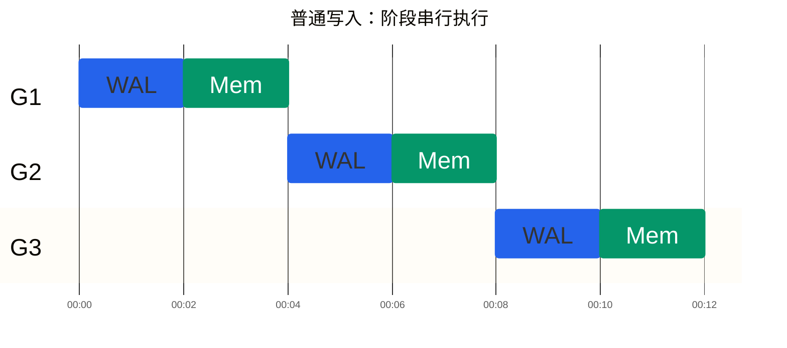
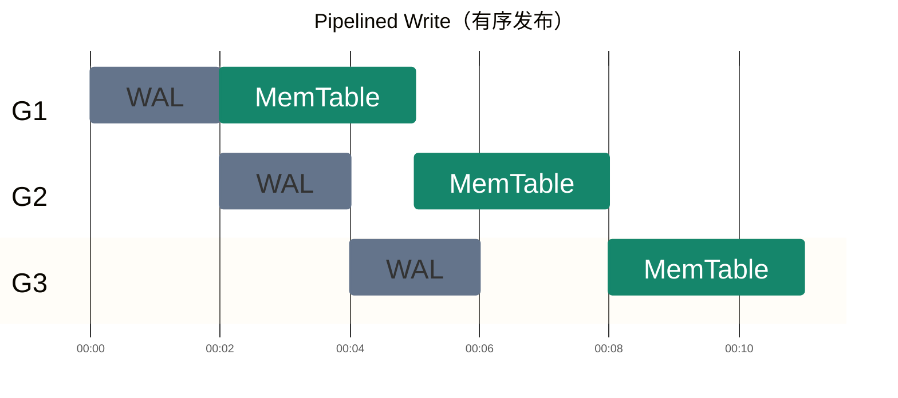
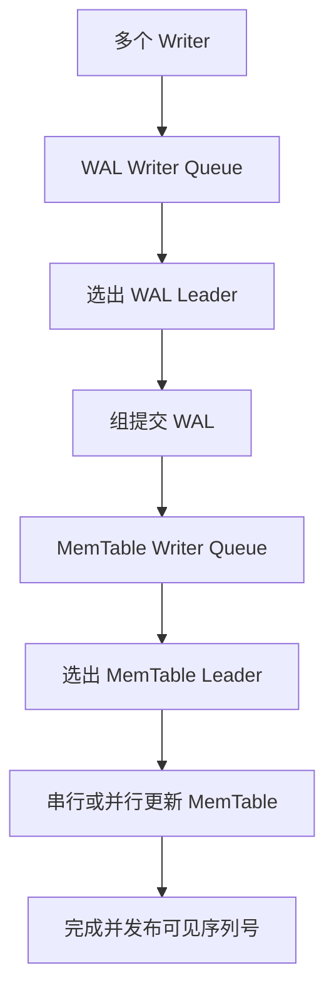

# 什么是 流水线写入 (pipelined write)

RocksDB 的 Pipelined Write（流水线写入），核心思想是：

让不同 Write Group 的 WAL 写入和 MemTable 写入同时进行，从而提高并发写入吞吐量。

它并不是让同一批数据同时写入 WAL 和 MemTable，而是让前一批数据更新 MemTable 的同时，后一批数据开始写 WAL。

## 1. 为什么需要流水线写入？
你已经知道 RocksDB 的普通写入路径：
```
WriteBatch
    ↓
写入 WAL
    ↓
写入 MemTable
    ↓
写入完成
```

假设有三个 Write Group：G1、G2、G3。

普通写入模式下，一个 Write Group 完成之后，下一个 Write Group 才能开始执行：



时间 →：每一组的两个阶段完成后，下一组才开始。蓝色表示 WAL，绿色表示 MemTable；时间刻度仅作示意，不代表实际耗时。

即使 G1 已经完成 WAL 写入、正在更新 MemTable，G2 仍然需要等待。

这意味着：
- G1 更新 MemTable 时，WAL 写入通道可能空闲。
- G2 无法利用这段时间推进自己的 WAL 写入。
- 并发线程较多时，等待会影响吞吐量。

## 2. 流水线写入怎么解决？

RocksDB 将写入拆成两个可协调的阶段：
1. WAL Phase：写入 WAL。
2. MemTable Phase：写入 MemTable。

于是，G1 进入 MemTable 阶段后，G2 就可以进入 WAL 阶段。



时间从左到右推进（较早 → 较晚）。灰蓝色表示 WAL，绿色表示 MemTable；时间刻度仅作示意，不代表实际耗时。

G2 的 WAL 可以与 G1 的 MemTable 执行重叠，但 G2 的 MemTable 要等 G1 的 MemTable 完成。G3 同理，各组 MemTable 阶段按顺序执行。

假设每组：
- WAL 写入需要 2 ms。
- MemTable 写入需要 3 ms。

在理想化、忽略协调开销的情况下：

| 模式 | 3 组写入完成时间 |
| --- | --- |
| 普通写入 | 15 ms |
| 流水线写入 | 11 ms |

这就是流水线带来的性能收益：不是缩短单个 Write Group 必须经历的两个阶段，而是增加不同 Write Group 之间的并行程度。

## 3. RocksDB 如何实现流水线？
关键设计是维护两个 Writer 队列。



它们的作用不同：

|队列 |作用 |
|WAL Writer Queue | 组织写入组，协调 WAL 写入 |
|MemTable Writer Queue | 协调已完成 WAL 阶段的 Writer 更新 MemTable |

在源码中，主要涉及：
```cpp
write_thread_.JoinBatchGroup(&w);
```

Writer 首先进入 WAL 写入队列。
```cpp
write_thread_.EnterAsBatchGroupLeader(...);
```

WAL Leader 组织 Write Group。

WAL 阶段结束后，需要更新 MemTable 的 Writer 被移交到 MemTable 队列。
```cpp
write_thread_.EnterAsMemTableWriter(...);
```


随后由 MemTable Leader 协调 MemTable 更新。

源码中的 WriteThread 也确实分别维护 newest_writer_ 和 newest_memtable_writer_，后者用于流水线模式。

## 4. 两个阶段重叠会不会破坏写入顺序？
这是你阅读这段源码时最值得关注的问题。

假设：
```
G1: Put("A", "100") → Seq 101
G2: Put("A", "200") → Seq 102
```

G1 已经进入 MemTable 阶段，G2 同时开始 WAL 阶段。

这不会直接造成问题，因为：

G2 完成 WAL 写入，不代表 G2 已经完成 MemTable 更新，也不代表其 Sequence Number 已经对读取可见。

RocksDB 必须协调：
1. WAL 中的记录顺序。
2. Sequence Number 的分配。
3. MemTable 更新的完成状态。
4. 已完成写入的可见性边界。

例如，不能仅仅因为 Seq 102 已经写入 WAL，就允许普通读取把 Seq 102 当作一个已经完成的写入结果。

这也是为什么流水线写入仍需要 Write Group、Leader、Follower 和 Sequence Number 机制。

它与之前讨论的 unordered_write 不同。流水线写入是在维持正常写入顺序语义的前提下重叠两个阶段；无序写入则采用不同的排序与可见性安排。RocksDB 也明确禁止同时启用 unordered_write 和 enable_pipelined_write。