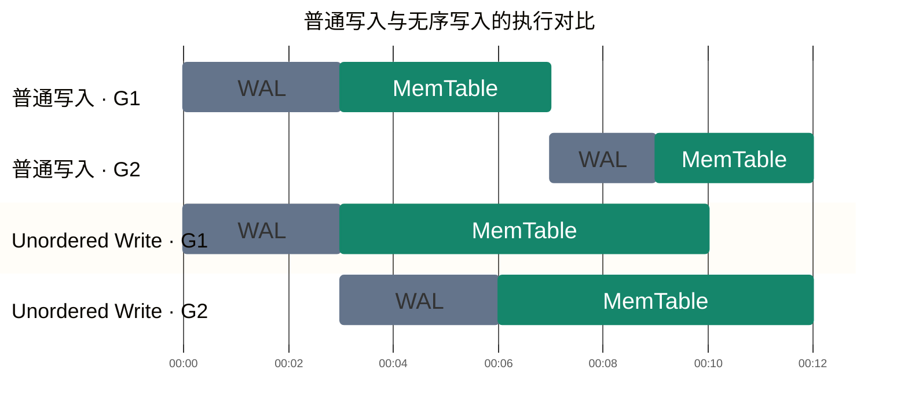
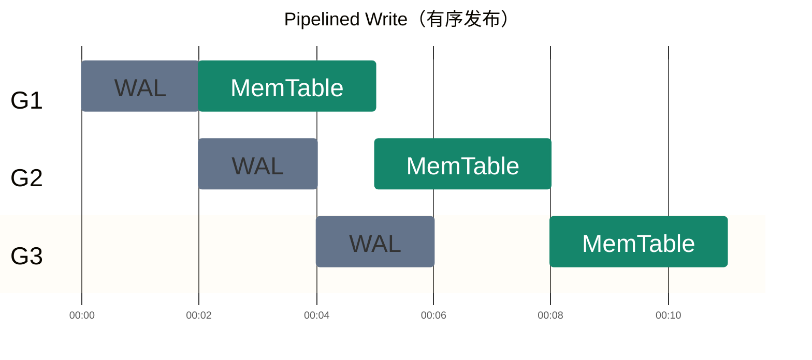
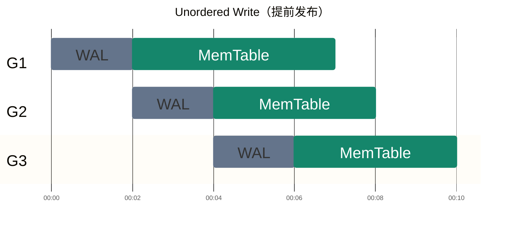
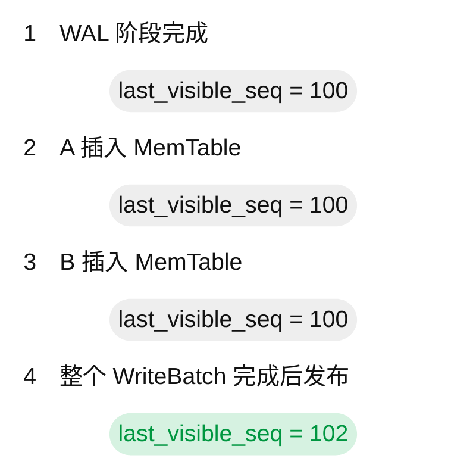
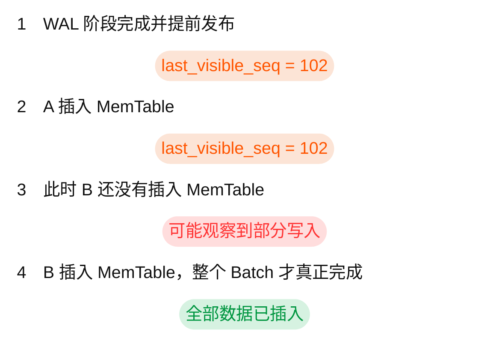

# 什么是 无序写入(Unorderd Write)

RocksDB 的 Unordered Write（无序写入）是一种优化高并发写入吞吐量的机制。

它的核心思想是：
>允许不同 Write Group 的 MemTable 写入并发执行，不再要求前一个 Write Group 完全写入 MemTable 后，下一个 Write Group 才能继续。

这样可以提高吞吐量，但代价是普通 RocksDB 的部分原子可见性和 Snapshot 一致性保证会被削弱。

这里的“无序”主要指 MemTable 写入的执行顺序不再严格跟随 [Write Group](./write_group.md) 的顺序，并不是 WAL 可以随意乱序。

## 一、设计动机：普通写入有什么性能问题？
回顾你正在学习的 DBImpl::WriteImpl()。

正常情况下，多个写入线程会组成一个 Write Group。

例如：
```
Write Group 1:
    Thread A
    Thread B

Write Group 2:
    Thread C
    Thread D
```

在普通写入模式下：
1. Group 1 的 Leader 分配 Sequence Number。
2. 将 Group 1 的数据写入 WAL（如果启用）。
3. 将 Group 1 的数据写入 MemTable。
4. 等待 Group 1 的 MemTable 写入全部完成。
5. 发布 Group 1 的可见序列号。
6. Group 2 才能继续。

即使开启 allow_concurrent_memtable_write，让 Group 1 内部的多个线程并发写 MemTable，Group 2 仍然受到 Group 1 完成屏障的约束。

为什么需要这个屏障？<br>
因为 RocksDB 必须保证：<br>
**当一组写入对读取者可见时，这组写入对应的数据已经全部插入 MemTable**。<br>
但是，这意味着：<br>
如果 Group 1 有一个线程的 MemTable 插入特别慢，Group 2 就必须等待。<br>
在高并发写入场景下，这种同步等待会限制吞吐量。

## 二、无序写入如何优化？

当设置：
options.unordered_write = true;

RocksDB 将 WAL 和 MemTable 的执行阶段分离。

在你给出的代码里：
if (immutable_db_options_.unordered_write) {
    WriteImplWALOnly(...);
    UnorderedWriteMemtable(...);
}

可以理解为两个阶段。

第一阶段：WriteImplWALOnly()<br>
这个阶段主要负责：
- 组织 Write Group。
- 为写入分配 Sequence Number。
- 按确定的顺序写入 WAL（如果启用）。
- 提前推进 last_visible_seq。
- 允许写入线程继续执行 MemTable 插入。

第二阶段：UnorderedWriteMemtable()<br>
各个线程执行自己的 MemTable 写入。

关键区别在于：

Group 1 尚未完成 MemTable 写入时，Group 2 就可以开始执行。



示意时间轴：从左到右表示时间推进，G1、G2 代表不同 Write Group；时间刻度仅用于展示相对顺序与重叠，不代表实际耗时。灰蓝色表示 WAL 阶段，绿色表示 MemTable 阶段。

- **普通写入**：G2 等待 G1 的 MemTable 写入全部完成。
- **Unordered Write**：G1、G2 的 MemTable 插入可以重叠执行。

## 三、最大的代价：可能看到部分 WriteBatch
这是理解 unordered_write 最重要的一点。

假设数据库最初有：
```
A = 100
B = 100
```

一个 WriteBatch 执行：
```cpp
WriteBatch batch;

batch.Put("A", "80");
batch.Put("B", "120");

db->Write(write_options, &batch);
```

正常模式下，RocksDB 要保证读取者不会看到只完成一部分的 Batch。

也就是说，读取者应当看到：
- 旧状态：A=100, B=100
- 新状态：A=80, B=120

而不应该看到：
```
A = 80
B = 100
```

但是在无序写入中，last_visible_seq 可能在 MemTable 插入完成之前就已经推进。

假设：
1. RocksDB 为这个 Batch 分配了 Sequence Number。
2. WAL 阶段完成，更新了 last_visible_seq。
3. Put(A,80) 已插入 MemTable。
4. Put(B,120) 还未插入。
5. 此时另一个线程读取数据。

那么就可能观察到：
```
A = 80
B = 100
```

这意味着：普通 RocksDB 开启 unordered_write 后，不能再依赖原有的 WriteBatch 原子读取保证。 

还有一个相关问题：Snapshot。

普通模式下，Snapshot 固定一个 Sequence Number，之后相同 Snapshot 的读取视图不会因为新写入而改变。

无序模式下，由于 Snapshot 取得的 Sequence Number 可能已经覆盖尚未完成的 MemTable 插入，同一个 Snapshot 的读取结果也可能随这些插入的完成而改变。

不过，unordered_write 仍保留了读到自己已完成写入的能力：写入调用返回时，对应的 MemTable 插入已经完成。

## 四、既然会破坏原子可见性，为什么还要使用？
因为有些场景更关注吞吐量：
- 高并发写入。
- 能容忍较弱读取一致性的场景。
- 上层已经有自己的事务与可见性控制机制。

例如，RocksDB 的 WritePrepared 事务模式配合 two_write_queues，可以通过独立的提交序列号及 last_published_seq 管理事务可见性，从而在使用无序写入时仍提供事务级的一致性保证。

因此，无序写入并不意味着 RocksDB 完全放弃顺序。

它实际上是把两个概念分开：
- 执行顺序（Execution Order）：MemTable 插入可以并发交错。
- 逻辑可见顺序（Visibility / Commit Order）：如果应用需要严格保证，就必须有额外机制控制。

## 五、与 Pipelined Write 的区别

这两个模式都想提高并发写吞吐量，但有所不同：

|对比 | Pipelined Write	| Unordered Write |
|--|--|--|
|核心优化 | 重叠不同写入组的 WAL 与 MemTable 阶段 | 允许不同写入组的 MemTable 阶段并发 |
|MemTable 执行 | 仍保留组间顺序约束 | 可以跨组交错 |
|原子读取 | 保留正常的可见性保证 | 普通 DB 模式下不再保证|
| Snapshot 稳定性 | 保留 | 普通 DB 模式下不再保证 |
|主要目的 | 减少 WAL 与 MemTable 阶段的等待 | 消除跨组 MemTable 完成屏障 |

[具体比较 回答](https://chatgpt.com/s/t_6ae9ad25266c8191a5864dc38d9b28ca)

### 1. 先看两种模式的执行过程

假设有三个 Write Group：G1、G2、G3。

每个 Group 都需要完成两个阶段：
- WAL：将写操作记录到日志（假设启用了 WAL）。
- MemTable：将 Key-Value 插入内存中的数据结构。

**两种写入模式的时间线**

下图是简化的并发示意，时间由左向右推进（较早 → 较晚），相同颜色表示相同的执行阶段。灰蓝色表示 WAL，绿色表示 MemTable；时间刻度仅作示意，不代表实际耗时。



G2 的 WAL 可以与 G1 的 MemTable 执行重叠，但 G2 的 MemTable 要等 G1 的 MemTable 完成。

---



G1、G2、G3 的 MemTable 插入可以同时进行，不必等待前一组全部完成。

### 2. Pipelined Write：解决 WAL 与 MemTable 串行的问题
普通写入的执行方式可以简化为：
```
G1: WAL → MemTable → 完成
G2:                    WAL → MemTable → 完成
```

G1 完成之后，G2 才能开始。

但仔细想想：

当 G1 已经写完 WAL，正在插入 MemTable 时，为什么不能让 G2 同时写 WAL？

两项操作使用的资源不同：
- G1 在执行内存数据结构的插入。
- G2 可以继续执行日志写入。

因此流水线写入将两阶段重叠：
```
G1: WAL → MemTable
G2:        WAL      → MemTable
G3:              WAL            → MemTable
```

关键：MemTable 阶段仍然需要保持组间顺序<br>
假设：
```
G1: Put(A, 100)
G2: Put(A, 200)
```

RocksDB 为它们分配：
```
G1: Seq = 101
G2: Seq = 102
```

在流水线模式下，允许 G2 的 WAL 写入与 G1 的 MemTable 插入重叠。

但 G2 的 MemTable 阶段仍然需要按照 Write Group 的顺序推进。

而且：

只有对应 Write Group 的 MemTable 插入全部完成之后，才可以安全地将该组的修改发布给读取者。

这样就能保证：
1. 读取者不会看见只插入一部分的 WriteBatch。
2. Snapshot 不会包含尚未完成插入的写入。
3. Sequence Number 对应的逻辑可见顺序保持一致。

所以，Pipelined Write 的主要收益来自 WAL 与 MemTable 阶段的重叠执行，而不是取消写入原子性

### 3. Unordered Write：进一步解决 MemTable 写入组之间的等待
现在考虑另一种情况。

即使使用 Pipelined Write，如果 G1 的 MemTable 插入很慢：
```
G1: MemTable 写入耗时 10ms
G2: MemTable 写入耗时 1ms
G3: MemTable 写入耗时 1ms
```

G2、G3 的 MemTable 写入仍然受 G1 的完成屏障约束。

这实际上引入了类似 Head-of-Line Blocking（队头阻塞）的问题。

如果 G1 与 G2 写入的是不同 Key，它们完全可能并发插入线程安全的 MemTable 数据结构。

因此 Unordered Write 采用更激进的方式：
1. 在 WAL 阶段为写入分配 Sequence Number。
2. 按顺序写入 WAL。
3. 在 MemTable 插入全部完成之前，就推进 last_visible_seq。
4. 释放写入线程，让不同 Write Group 并发执行 MemTable 插入。

举个例子：
```
G1: Put(A, 100)   Seq=101
G2: Put(B, 200)   Seq=102
G3: Put(C, 300)   Seq=103
```

可能出现：
|时刻|已完成 MemTable 插入|
|--|--|
|T1|G3：C=300|
|T2|G2：B=200|
|T3|G1：A=100|

注意，这不表示 Sequence Number 被乱序分配。

Sequence Number 仍然按逻辑顺序分配，只是数据进入 MemTable 的完成顺序可能与 Sequence Number 顺序不同。

但这会引出一个很重要的问题。

### 核心区别：Sequence Number 的发布时机
这才是两种机制在正确性上的根本区别。

假设一个 WriteBatch：
```cpp
WriteBatch batch;

batch.Put("A", "100");
batch.Put("B", "200");
```

为两个修改分配的序列号分别是：
```
A: Seq = 101
B: Seq = 102
```

最初 last_visible_seq = 100。

**Pipelined Write**



因此，普通读取者要么看不到这两个修改，要么能看到全部修改。

**Unordered Write**


为什么会有问题？

因为 RocksDB 的 Snapshot 通常使用可见 Sequence Number 作为读取上界。

假设取得：
```
Snapshot Seq = 102
```

那么该 Snapshot 允许读取 Sequence Number 不超过 102 的数据。

但是在 Unordered Write 中：
- A（Seq=101）可能已经插入。
- B（Seq=102）可能还没插入。

因此，读取者可能看到 A 的新值、B 的旧值。

等 B 插入 MemTable 后，同一个 Snapshot 再次读取 B，还可能得到新的结果。

这破坏了两个保证：
- Atomic Visibility（原子可见性）：一个 Batch 的修改应当整体可见。
- Immutable Snapshot（不可变快照）：同一个 Snapshot 的读取视图应当保持稳定。