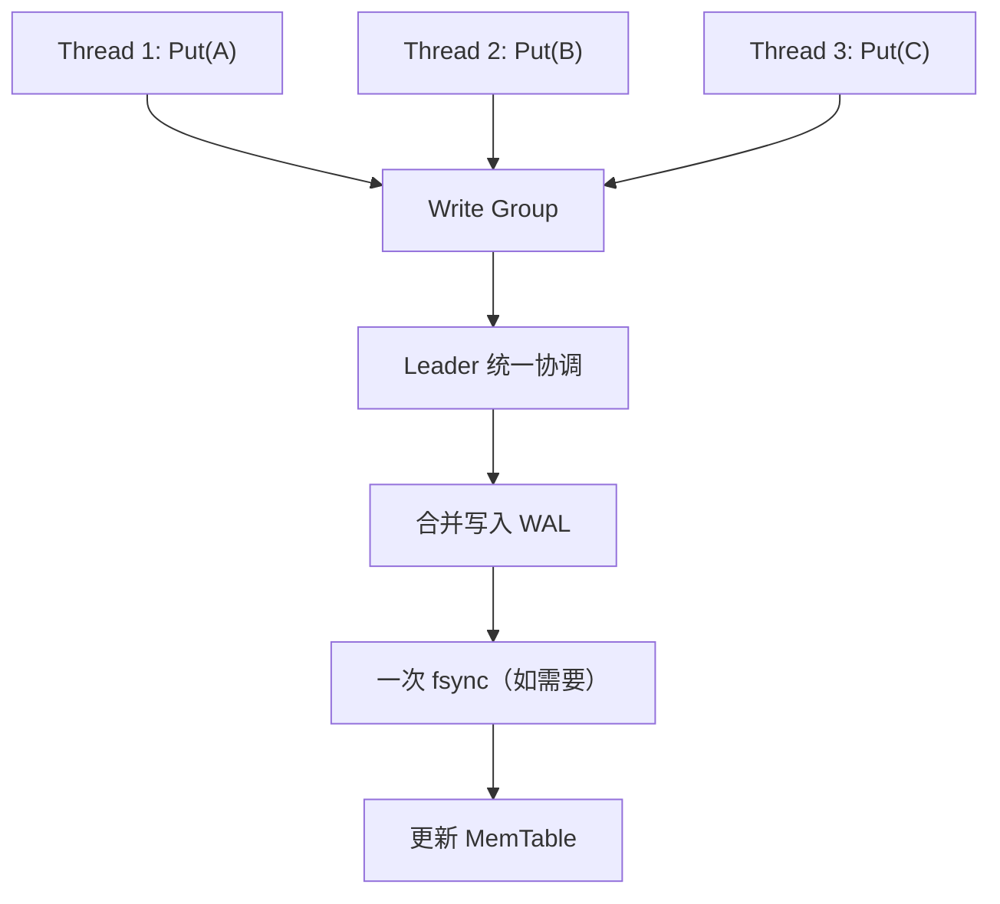

# 什么是 write group

在 RocksDB 中，Write Group（写入组）是将多个并发线程的写入请求组织在一起，由一个 Leader 统一协调执行的机制。

它的核心目标是：
1. 提高写入吞吐量：将多个写入请求合并，减少 WAL 写入和 fsync 的开销。
2. 协调并发写入：管理多个线程的写入顺序。
3. 保证正确的可见性：结合 Sequence Number，确保读取不会观察到不符合写入语义的中间状态。

这也是 RocksDB 实现 Group Commit（组提交） 的基础。

## 1. 为什么需要 Write Group？

假设三个线程同时向 RocksDB 写入：

```cpp
// Thread 1
db->Put(options, "A", "100");

// Thread 2
db->Put(options, "B", "200");

// Thread 3
db->Put(options, "C", "300");
```

如果没有 Group Commit，并且每次写入都要求 sync=true，可能发生：

| 线程 | WAL 写入 | fsync|
|--- |--- |--- |
| Thread 1 | 写入 A | 1 次 |
| Thread 2 | 写入 B | 1 次 |
| Thread 3 | 写入 C | 1 次 |

每次 fsync 都可能引入较高的 I/O 延迟。

RocksDB 因此引入 Write Group，让这些请求有机会合并执行：



这样可以将多个写入请求的 WAL I/O 成本分摊。

注意：这里的一次 fsync 是组提交的典型情况，并不是每个 Write Group 都必须调用 fsync。如果没有请求要求同步持久化，可能不需要它。

## 2. Write Group 是怎么工作的？

在普通的 DBImpl::WriteImpl() 写入路径中，可以把过程分成四步。

**第一步：线程进入 WriteThread**<br>
每个调用 WriteImpl() 的线程都会构造一个 Writer 对象。<br>
```cpp
WriteThread::Writer w(...);

write_thread_.JoinBatchGroup(&w);
```
Writer 保存当前写入请求的相关信息，例如：
- batch：对应的 WriteBatch。
- sync：是否要求同步 WAL。
- disable_wal：是否禁用 WAL。
- state：当前 Writer 的状态。
- sequence：分配的起始 Sequence Number。

这里的 WriteThread 并不是一个专门执行写入的后台线程，而是 RocksDB 用于协调并发写入请求的组件。

**第二步：选择 Leader 和 Followers**<br>
假设有三个 Writer：<br>
```
Writer 1 → Leader
Writer 2 → Follower
Writer 3 → Follower
```

Leader 负责建立 Write Group：<br>
```cpp
WriteThread::WriteGroup write_group;

write_thread_.EnterAsBatchGroupLeader(
    &w, &write_group
);
```
同一组中的 Follower 通常会等待 Leader 完成协调工作；如果启用了并行 MemTable 写入，它们也可能被唤醒参与写入。

需要注意，Write Group 是动态形成的，并不是每三个或每十个请求固定组成一组。如果没有其他请求可以合并，一个 Write Group 完全可能只有一个 Writer。

**第三步：Leader 执行组写入**<br>
假设 Write Group 包含三个 WriteBatch：
Write Group
├── Writer 1 → Batch A
├── Writer 2 → Batch B
└── Writer 3 → Batch C


Leader 将它们组织成一次组提交：
1. 汇总需要写入 WAL 的 WriteBatch。
2. 按确定的顺序分配 Sequence Number。
3. 将相关数据写入 WAL，并按要求同步。
4. 更新 MemTable。

其中 MemTable 写入存在两种主要形式：
- 串行写入：由 Leader 完成组内 Writer 的 MemTable 插入。
- 并行写入：由 Leader 协调多个 Writer 并发更新 MemTable。

最终还需要正确处理组内写入的完成状态和可见性。

**第四步：完成写入并唤醒 Followers**<br>
Leader 完成组提交后，调用相应的退出逻辑：
```cpp
write_thread_.ExitAsBatchGroupLeader(
    write_group, status
);
```

随后组内等待的 Writer 可以获知执行结果，后续等待队列中的 Writer 也有机会成为下一组的 Leader。

## 3. Write Group 和 WriteBatch 有什么区别？

这是阅读 RocksDB 写入源码时非常重要的区别。

|对比|WriteBatch|Write Group|
|---|---|---|
|定义|多条 KV 修改组成的批次|多个 Writer 组成的写入组|
|形成方式|通常由调用者构造|RocksDB 内部动态组织|
|核心目的|保证批次内修改的原子性|提高并发写入效率|
|内部包含|多个 Put/Delete/Merge 等操作|一个或多个 Writer，各自对应 WriteBatch|
|原子性 | 单个 WriteBatch 具有原子写入语义 | 不意味着多个 WriteBatch 构成一个事务|

例如：
```cpp
WriteBatch batch1;
batch1.Put("A", "100");
batch1.Put("B", "200");

WriteBatch batch2;
batch2.Put("C", "300");
```

两个线程分别提交 batch1 和 batch2，RocksDB 可能将它们组织到同一个 Write Group 中。

但这并不意味着两个 WriteBatch 被合并成了一个对用户提供整体事务原子性的 WriteBatch。

